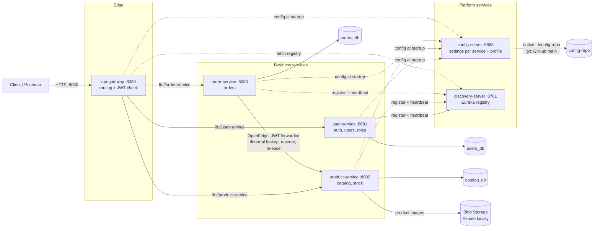
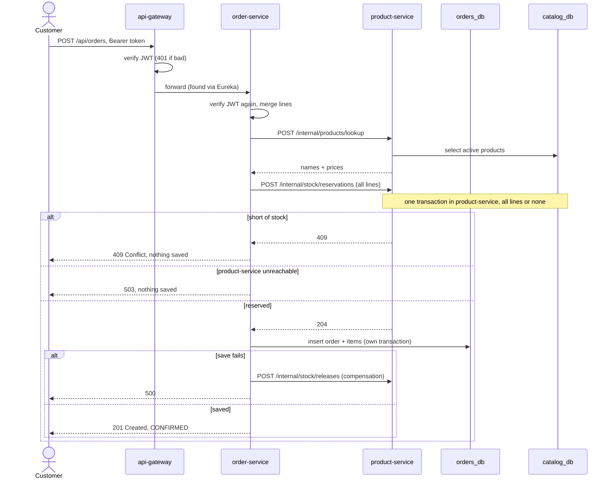
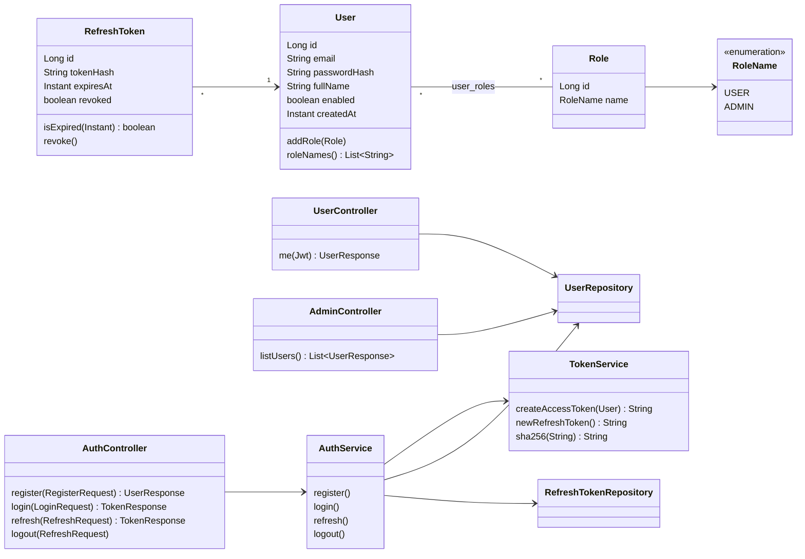
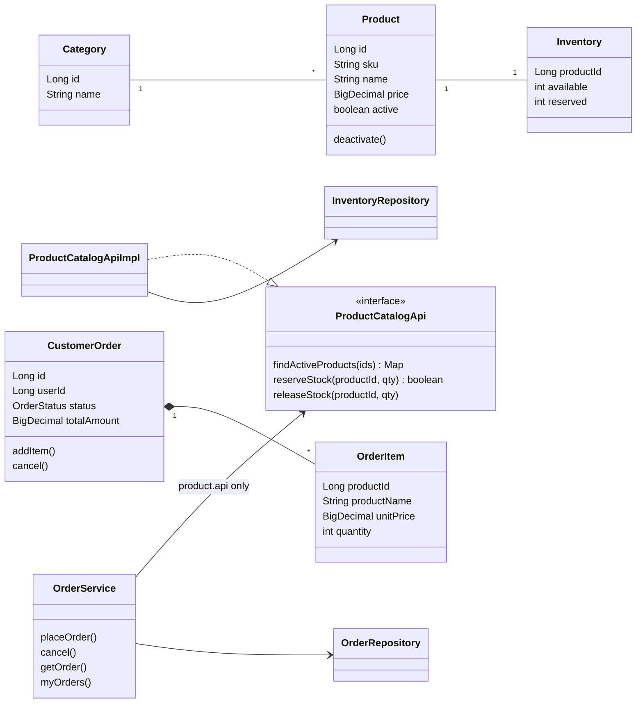
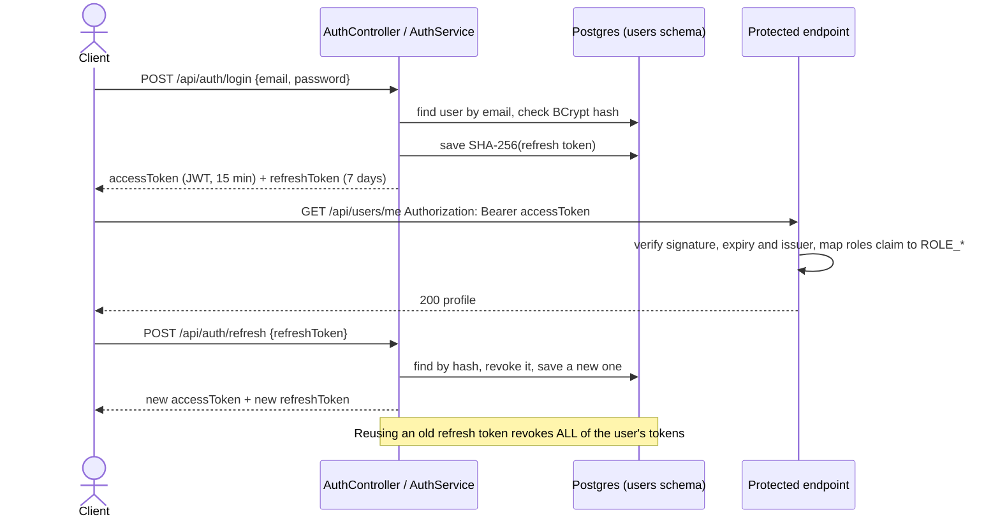

# Architecture (microservices, Sessions 4-5)

Running on Azure (AKS, PostgreSQL, Blob Storage) is described in [azure-deploy.md](azure-deploy.md).
This page shows the services themselves, as they run locally in Docker Compose.

Six Spring Boot apps plus Postgres (and Azurite, the Blob Storage emulator, for product images). Each business service owns one database; services only talk
over HTTP. GitHub renders the Mermaid diagrams below automatically.

## Component diagram



Solid arrows = request traffic. Dotted arrows = platform traffic (registration, config).
The three databases live on one Postgres container locally; nothing joins across them.

## What changed from the monolith

| Before (Session 3) | Now (Session 4) |
|---|---|
| One app, one deploy | 6 apps, each built and deployed on its own (`docker compose up --build order-service`) |
| One database, 3 schemas | 3 databases, one per service |
| `application.yml` inside the jar | Config Server serves `config-repo/`, with `local` and `azure` profiles |
| order module calls `ProductCatalogApi` (a Java call) | order-service calls product-service over HTTP via OpenFeign, found by name in Eureka |
| One database transaction for "reserve stock + save order" | Two local transactions plus a compensating `release` if saving fails |
| Client talks to the app on 8080 | Client talks to the gateway on 8080; services aren't exposed |

## New failure points (and what we do about each)

A Java method call can't time out or find the other side switched off. An HTTP call can.

| Failure | What the customer sees | How it's handled |
|---|---|---|
| product-service down | Browse: 503. Place order: 503. Login, profile, my orders: still work | Gateway and Feign find no instance in Eureka; `RemoteProductCatalog` turns it into a clean 503 |
| product-service slow | 503 after 3 s instead of hanging | Feign timeouts: connect 2 s, read 3 s. Gateway response timeout 5 s |
| Not enough stock | 409 with product-service's message | product-service rolls back all lines; order-service passes the message on |
| orders_db fails after stock was reserved | 500, stock returned | Compensating action: `release` the reserved stock |
| Reply lost after stock was reserved (timeout) | 503, stock stays reserved | **Known gap.** Fixed in Session 7 with Kafka events + idempotency |
| Cancel while product-service is down | 503, order stays CONFIRMED, retry later | Release happens inside the local transaction, so a failure rolls back the cancel |
| Config server down at startup | Service won't start (compose waits for it to be healthy) | Running services keep their config; only new starts need it |
| Eureka down | Existing calls keep working for a while | Clients cache the registry; new instances can't be found until it's back |
| Stale registry right after a stop | A few seconds of errors | Graceful shutdown deregisters; fetch interval and LB cache cut to 5 s |

## Placing an order across services



Design decisions:
- **No database transaction held during network calls.** `placeOrder` is not `@Transactional`;
  only the final save runs in a `TransactionTemplate`. Holding a transaction while waiting on the
  network would tie up connections and locks for as long as the network is slow.
- **One reservation call for all lines**, so product-service can keep it all-or-nothing in one
  local transaction (and keep the product-id ordering that prevents deadlocks).
- **`/internal/**` endpoints are not routed by the gateway.** They still require a valid JWT:
  order-service forwards the customer's token (`FeignConfig`).
- **JWT checked twice:** at the gateway (reject early, protect services) and in each service
  (zero trust: a request that gets past the gateway, or comes from inside, is still checked).
- **Still no call to user-service:** the user id comes from the JWT `sub` claim.
- **The gateway is reactive** (WebFlux), so it has its own small security config instead of
  using the `common` module, which is Spring MVC.

## Product images (Session 5)

- `POST /api/products/{id}/image` (admin, multipart): product-service checks the file's first bytes
  (real JPEG / PNG / WebP only, at most 2 MB; the file name and Content-Type aren't trusted), stores it
  in Blob Storage as `products/{id}/{random}.{ext}` and saves the public URL on the product.
- Browsers load images **straight from Blob Storage** by URL: the bytes never go through the gateway
  or the services. The container allows anonymous read of single blobs; writing needs the account key,
  which only product-service has.
- `ImageStorage` is an interface: `AzureBlobImageStorage` on Azure and with Azurite locally, a mock in
  tests. Without a connection string, uploads answer 503 and everything else keeps working.

## Configuration

```
config-repo/
  application.yml           shared by every service: JWT, Eureka, actuator
  application-local.yml     profile local: Postgres on localhost / compose
  application-azure.yml     profile azure: Azure Postgres with sslmode=require
  user-service.yml          one file per service: its database, its own settings
  product-service.yml
  order-service.yml         Feign timeouts
  api-gateway.yml
```

A service asks the config server for `<name>` + `<profile>` and gets the files merged
(most specific wins). Secrets are never in the repo: files use `${JWT_SECRET}`-style placeholders
filled from environment variables. Backend: `native` (read the folder, default in compose) or
`git` (read `config-repo/` on GitHub `main`): `set CONFIG_BACKEND=git` before `docker compose up`.

## User module classes (Session 2)



Tables (schema `users`): `users`, `roles`, `user_roles`, `refresh_tokens` - see `V2__create_user_tables.sql`.

## Product and order classes (Session 3)



- Session 4: `ProductCatalogApi` is gone. order-service now has its own `ProductCatalog` port,
  implemented by `RemoteProductCatalog` over HTTP. The boundary is enforced by Maven modules
  (order-service simply can't import product-service classes), so the ArchUnit test was retired.
- `CustomerOrder.userId` and `OrderItem.productId` are plain ids, not JPA relationships and not
  foreign keys across schemas, so the modules can move to separate databases in Session 4.
- Order items copy the product name and price at order time.

## Testing strategy

| Level | Example | What it checks | Speed |
|---|---|---|---|
| Unit (JUnit + Mockito) | `AuthServiceTest`, `OrderServiceTest`, `RemoteProductCatalogTest` | Business rules, compensation when a save fails, how remote errors become 409 / 503 / 502 | milliseconds |
| Web slice (`@WebMvcTest`) | `UserWebLayerTest` | URLs, JSON, validation errors, status codes, security rules; service mocked | ~2 s |
| Service integration (`@SpringBootTest` + Testcontainers) | `AuthFlowIntegrationTest`, `ProductServiceIntegrationTest`, `OrderApiIntegrationTest` | One service against a real Postgres; other services mocked at the Feign client | ~20 s each |
| Gateway (`WebTestClient`) | `GatewaySecurityTest` | Bad or missing tokens stopped at the edge; good ones forwarded | ~5 s |
| System (manual / script) | `scripts/failure-demo.ps1` | Whole stack in Docker; stop product-service, the rest stays up | ~2 min |

Each service's tests run with Config Server and Eureka switched off
(`src/test/resources/config/application.yml`), so they run alone and in CI.

## Login and token refresh (Session 2)



Security decisions:
- **Stateless JWT access tokens** (HS256): any instance can verify them without a database lookup,
  which matters once the app is split into services (Session 4).
- **Short access-token life + revocable refresh tokens**: a stolen access token works for at most
  15 minutes; refresh tokens can be revoked (logout) and are rotated on every use.
- **Only hashes are stored**: BCrypt for passwords, SHA-256 for refresh tokens.
- **Roles** live in the `roles` claim and become Spring authorities `ROLE_USER` / `ROLE_ADMIN`.
  `/api/admin/**` is protected by a URL rule and by `@PreAuthorize`.
