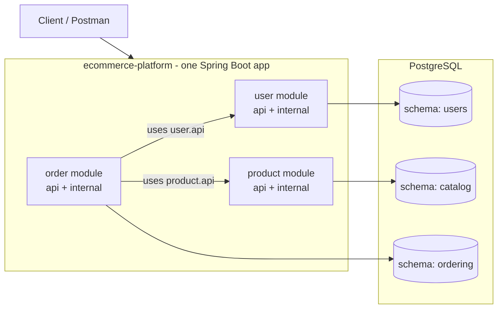
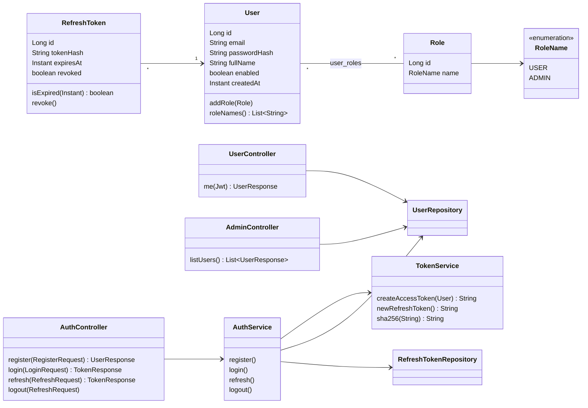
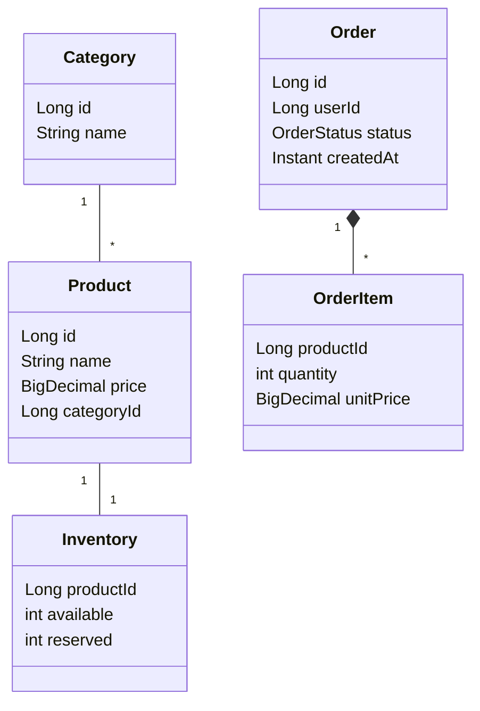
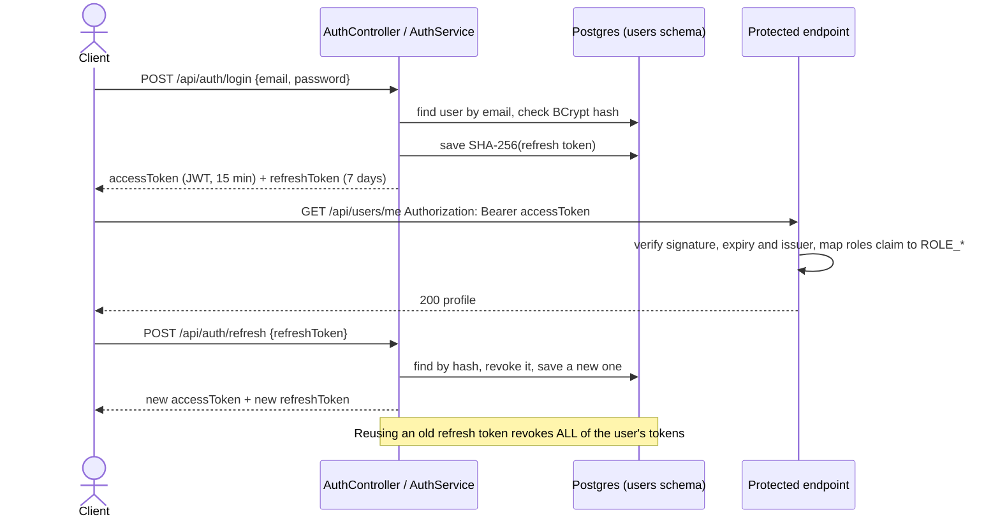

# Architecture (modular monolith)

One Spring Boot app, three modules, one Postgres database with one schema per module.
GitHub renders the Mermaid diagrams below automatically.

## Module diagram

Rules:
- A module only reads and writes its own schema.
- Other modules call it only through its `api` package. `ModuleBoundariesTest` enforces this.
- In Session 4 each module becomes its own service, and each schema its own database.

## User module classes (Session 2)

Tables (schema `users`): `users`, `roles`, `user_roles`, `refresh_tokens` - see `V2__create_user_tables.sql`.

## Product and order classes (draft, built in Session 3)

Note: `Order.userId` and `OrderItem.productId` are plain IDs, not JPA relationships across modules.
That keeps the modules separable.

## Testing strategy

| Level | Example | What it checks | Speed |
|---|---|---|---|
| Unit (JUnit + Mockito) | `AuthServiceTest` | Business rules, e.g. refresh-token reuse revokes all sessions | milliseconds |
| Web slice (`@WebMvcTest`) | `UserWebLayerTest` | URLs, JSON, validation errors, status codes, security rules; service mocked | ~2 s |
| Integration (`@SpringBootTest` + Testcontainers) | `AuthFlowIntegrationTest` | Whole flow against a real Postgres | ~20 s |
| Architecture (ArchUnit) | `ModuleBoundariesTest` | No module reaches into another module's `internal` package | ~1 s |

## Login and token refresh (Session 2)

Security decisions:
- **Stateless JWT access tokens** (HS256): any instance can verify them without a database lookup,
  which matters once the app is split into services (Session 4).
- **Short access-token life + revocable refresh tokens**: a stolen access token works for at most
  15 minutes; refresh tokens can be revoked (logout) and are rotated on every use.
- **Only hashes are stored**: BCrypt for passwords, SHA-256 for refresh tokens.
- **Roles** live in the `roles` claim and become Spring authorities `ROLE_USER` / `ROLE_ADMIN`.
  `/api/admin/**` is protected by a URL rule and by `@PreAuthorize`.
