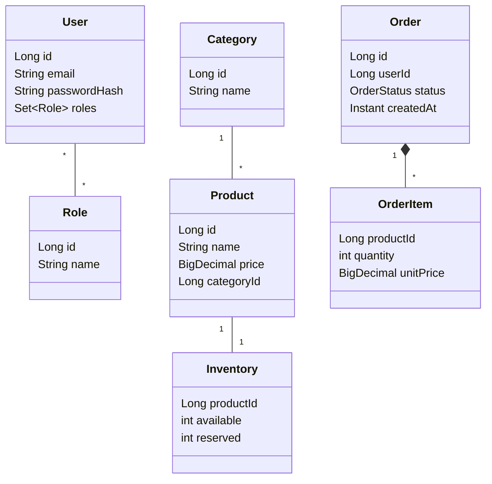

# Architecture — Session 1 (modular monolith)

One Spring Boot app, three modules, one Postgres database with one schema per module.
GitHub renders the Mermaid diagrams below automatically.

## Module diagram

```mermaid
flowchart LR
    client[Client / Postman] --> app

    subgraph app[ecommerce-platform - one Spring Boot app]
        direction TB
        user[user module<br/>api + internal]
        product[product module<br/>api + internal]
        order[order module<br/>api + internal]
        order -- "uses user.api" --> user
        order -- "uses product.api" --> product
    end

    subgraph db[(PostgreSQL)]
        s1[(schema: users)]
        s2[(schema: catalog)]
        s3[(schema: ordering)]
    end

    user --> s1
    product --> s2
    order --> s3
```

Rules:
- A module only reads and writes its own schema.
- Other modules call it only through its `api` package. `ModuleBoundariesTest` enforces this.
- In Session 4 each module becomes its own service, and each schema its own database.

## First-draft class diagram (filled in during Sessions 2–3)



Note: `Order.userId` and `OrderItem.productId` are plain IDs, not JPA relationships across modules.
That keeps the modules separable.
