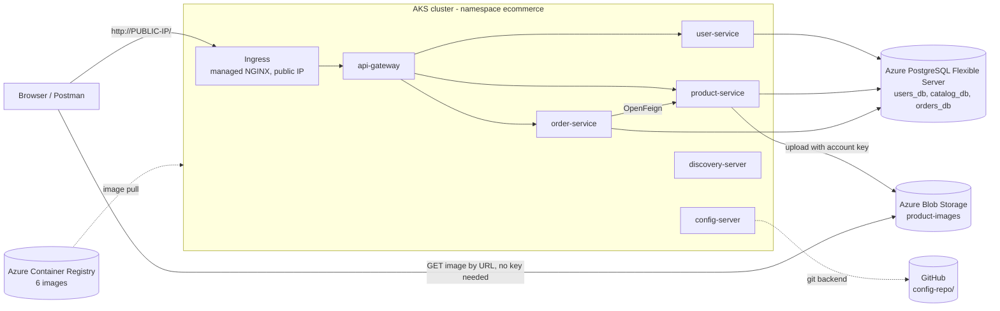

# Deploying to Azure (Session 5)

The same 6 containers that run in Docker Compose, running on **Azure Kubernetes Service**, with
**Azure Database for PostgreSQL** instead of the Postgres container and **Azure Blob Storage**
for product images.

## Azure architecture



What lives where:

| Piece | Azure service | Why this choice |
|---|---|---|
| Containers | AKS, 1 node `Standard_B2ms` (2 vCPU, 8 GB) | Smallest size that fits 6 JVMs; Free tier control plane |
| Images | Azure Container Registry, Basic | Private registry; `--attach-acr` lets AKS pull without passwords |
| Databases | PostgreSQL Flexible Server, Burstable B1ms | Managed backups, patching, TLS. 3 databases on one server to save money |
| Product images | Blob Storage, `product-images` container | Files don't belong in a database; browsers load them straight from storage |
| Public entry | AKS application routing add-on (managed NGINX) | One public IP, all traffic goes to the gateway |
| Config | config-server, git backend, reads GitHub | Same config-repo as locally, `azure` profile |
| Secrets | Kubernetes Secret `ecommerce-secrets` | Created by deploy.ps1 from values that are never committed. Stretch goal: Key Vault |

## Kubernetes objects (k8s/)

| File | Objects | Notes |
|---|---|---|
| `00-namespace.yaml` | Namespace `ecommerce` | Everything in one place |
| `01-configmap.yaml` | ConfigMap `ecommerce-config` | Profile `azure`, config server and Eureka addresses, DB host, JVM memory flags |
| `10`, `11` | Deployment + Service | config-server, discovery-server; deployed and waited for first |
| `20`-`22`, `30` | Deployment + Service | the 3 business services and the gateway; DB / JWT / storage secrets from the Secret |
| `40-ingress.yaml` | Ingress | Only the gateway is public; every Service is ClusterIP |

Every Deployment has:
- **startupProbe** (`/actuator/health/liveness`): up to 5 minutes for a slow JVM start before liveness checks begin.
- **livenessProbe**: if the app hangs, Kubernetes restarts the container.
- **readinessProbe** (`/actuator/health/readiness`): no traffic until the app is ready.
- **Memory request and limit**, with `-XX:MaxRAMPercentage=60` so the JVM sizes its heap from the container limit.

**Dockerfiles:** one multi-stage `Dockerfile` serves all 6 modules through the `MODULE` build
argument (`docker build --build-arg MODULE=order-service .`). Stage 1 builds the jar with Maven,
stage 2 is a small JRE image running as a non-root user. That's one file to maintain instead of 6
copies of the same file.

## Run it

Needs: the Azure CLI (`winget install -e --id Microsoft.AzureCLI`), Docker Desktop running,
and kubectl (included with Docker Desktop).

```
powershell -ExecutionPolicy Bypass -File scripts\azure\setup-azure.ps1      (once per session, ~25 min)
git push                                                                     (config server reads GitHub)
powershell -ExecutionPolicy Bypass -File scripts\azure\deploy.ps1           (~10-15 min, prints the URL)
powershell -ExecutionPolicy Bypass -File scripts\upload-demo-images.ps1 -BaseUrl http://IP -AdminEmail ... -AdminPassword ...
powershell -ExecutionPolicy Bypass -File scripts\azure\status.ps1           (what's running)
powershell -ExecutionPolicy Bypass -File scripts\azure\teardown.ps1         (END OF EVERY SESSION)
```

## Cost control

Everything is in one resource group, `rg-ecommerce`, so `teardown.ps1` deletes it all with
one command. The cluster node, the database server and the registry all bill by the hour while
they exist, even when nobody uses the app. **Run teardown at the end of every session**, then check
with `az group list --output table` about 10 minutes later. Rebuilding takes about 35 minutes
with the two scripts. That's the point of having scripts.

Also set a **budget alert** once: Azure portal, Cost Management, Budgets, e.g. $20 a month with an
email at 50%.

## Troubleshooting

| Symptom | Likely cause | Fix |
|---|---|---|
| `setup-azure.ps1`: "not available in this region" or quota error | Free subscriptions can't use every size in every region | `teardown.ps1`, then `setup-azure.ps1 -Location westus2` (or `centralus`) |
| Pod stays `CrashLoopBackOff` right after deploy | Started before config-server was ready | Usually fixes itself in 1-2 minutes. Otherwise: `kubectl logs deployment/<name> -n ecommerce` |
| Pod `OOMKilled` | Memory limit too low | Raise `limits.memory` for that service in k8s/, redeploy |
| Pod `ImagePullBackOff` | AKS can't pull from ACR | `az aks update -g rg-ecommerce -n aks-ecommerce --attach-acr <acr name>` |
| Service log: "password authentication failed" / "connection refused" to postgres | Wrong secret or firewall | `kubectl get secret ecommerce-secrets -n ecommerce`; check the firewall rule `AllowAllAzureServices...` in the portal |
| Upload returns 503 "Image storage is not configured" | Secret missing STORAGE_CONNECTION_STRING | Rerun deploy.ps1 |
| Image URL returns 409 "Public access is not permitted" | Storage account blocks anonymous blob reads | `az storage account update -n <storage> -g rg-ecommerce --allow-blob-public-access true` |
| Config looks old on AKS | config-server reads GitHub, not your PC | `git push`, then `kubectl rollout restart deployment -n ecommerce` |
