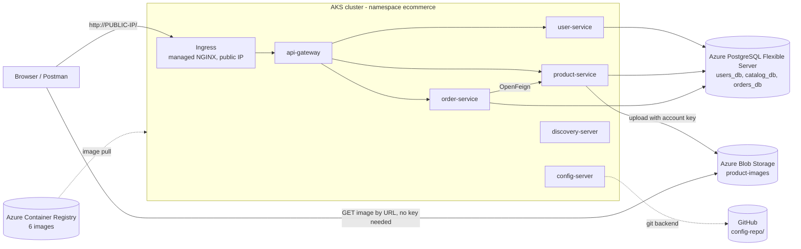

# Deploying to Azure (Sessions 5-6)

The same 6 containers that run in Docker Compose, running on **Azure Kubernetes Service**, with
**Azure Database for PostgreSQL** instead of the Postgres container and **Azure Blob Storage**
for product images.

## Azure architecture



What lives where:

| Piece | Azure service | Why this choice |
|---|---|---|
| Containers | AKS, 1 node `Standard_D2as_v7` (2 vCPU, 8 GB, x86) | Smallest size that fits 6 JVMs; Free tier control plane |
| Images | Azure Container Registry, Basic | Private registry; `--attach-acr` lets AKS pull without passwords |
| Databases | PostgreSQL Flexible Server, Burstable B1ms | Managed backups, patching, TLS. 3 databases on one server to save money |
| Product images | Blob Storage, `product-images` container | Files don't belong in a database; browsers load them straight from storage |
| Public entry | AKS application routing add-on (managed NGINX) | One public IP, all traffic goes to the gateway |
| Config | config-server, git backend, reads GitHub | Same config-repo as locally, `azure` profile |
| Secrets | Kubernetes Secret `ecommerce-secrets` | Generated by Terraform, copied into the Secret by infra-up.ps1; never committed. Stretch goal: Key Vault |

## Kubernetes objects (Helm, since Session 6)

Session 5 used plain YAML files in `k8s/`. Session 6 turned them into Helm charts, so each service
is its own Helm release and can be deployed on its own (that's what the per-service pipelines do).

| Release | Chart | Objects | Installed by |
|---|---|---|---|
| `platform` | `charts/platform` | ConfigMap `ecommerce-config`, Secret `ecommerce-secrets`, Ingress | `infra-up.ps1`, from Terraform outputs |
| one per service (6) | `charts/service` + `deploy/values/<service>.yaml` | Deployment + Service | the service's pipeline, or `deploy.ps1` |

Every Deployment has:
- **startupProbe** (`/actuator/health/liveness`): up to 5 minutes for a slow JVM start before liveness checks begin.
- **livenessProbe**: if the app hangs, Kubernetes restarts the container.
- **readinessProbe** (`/actuator/health/readiness`): no traffic until the app is ready.
- **CPU request of 25m** (a scheduling reservation; the apps can still use spare CPU) and a **memory request and limit**, with `-XX:MaxRAMPercentage=60` so the JVM sizes its heap from the container limit.
- **Rollout strategy maxSurge 0 / maxUnavailable 1**: on one small node the old pod stops before the new one starts.

**Dockerfiles:** one multi-stage `Dockerfile` serves all 6 modules through the `MODULE` build
argument (`docker build --build-arg MODULE=order-service .`). Stage 1 builds the jar with Maven,
stage 2 is a small JRE image running as a non-root user.

## Run it

Needs: Azure CLI, Terraform, Helm, kubectl (Docker Desktop includes it), Docker Desktop running.

```
az login
powershell -ExecutionPolicy Bypass -File scripts\azure\infra-up.ps1      (Terraform: ~15-20 min)
git push                                                                (config-server reads GitHub)
powershell -ExecutionPolicy Bypass -File scripts\azure\deploy.ps1        (by hand; or let the pipelines deploy)
powershell -ExecutionPolicy Bypass -File scripts\upload-demo-images.ps1 -BaseUrl http://IP -AdminEmail ... -AdminPassword ...
powershell -ExecutionPolicy Bypass -File scripts\azure\status.ps1        (what's running)
powershell -ExecutionPolicy Bypass -File scripts\azure\infra-down.ps1    (END OF EVERY SESSION)
```

## Cost control

Everything is in `rg-ecommerce`, created and destroyed by Terraform. The cluster node, the database
server, the registry and the public IP bill by the hour while they exist (about $4/day), even when
nobody uses the app. **Run infra-down.ps1 at the end of every session.** Only `rg-ecommerce-tfstate`
(Terraform's state, a few cents a month) stays.

Also set a **budget alert** once: Azure portal, Cost Management, Budgets, e.g. $20 a month with an
email at 50%.

## Troubleshooting

| Symptom | Likely cause | Fix |
|---|---|---|
| Terraform: "location is restricted" or "VM size not allowed" | Free subscriptions can't use every size in every region | Change `location` in terraform.tfvars or `node_size` in variables.tf, then infra-down + infra-up |
| Terraform: name "already in use" after a destroy | Azure still reserves a just-deleted name | Wait 15 minutes, or change `suffix` in terraform.tfvars (then update the ecommerce-azure variable group) |
| Pod stays `CrashLoopBackOff` right after deploy | Started before config-server was ready | Usually fixes itself in 1-2 minutes. Otherwise: `kubectl logs deployment/<name> -n ecommerce` |
| Pod stays `Pending`, events say "Insufficient cpu" | The node's CPU is already reserved (AKS's own system pods take a lot of a 2-CPU node) | CPU requests are 25m per app (a reservation, not a limit: apps still use spare CPU). Still full? `az aks scale -g rg-ecommerce -n aks-ecommerce --node-count 2` |
| Pod `OOMKilled` | Memory limit too low | Raise `resources.limits.memory` in deploy/values/<service>.yaml, redeploy |
| Pod `ImagePullBackOff` | AKS can't pull from ACR | `az aks update -g rg-ecommerce -n aks-ecommerce --attach-acr <acr name>` |
| Service log: "password authentication failed" / "connection refused" to postgres | Wrong secret or firewall | `kubectl get secret ecommerce-secrets -n ecommerce`; check the firewall rule `AllowAllAzureServices...` in the portal |
| Upload returns 503 "Image storage is not configured" | Secret missing STORAGE_CONNECTION_STRING | Rerun infra-up.ps1 (it reinstalls the platform release) |
| Image URL returns 409 "Public access is not permitted" | Storage account blocks anonymous blob reads | `az storage account update -n <storage> -g rg-ecommerce --allow-blob-public-access true` |
| Config looks old on AKS | config-server reads GitHub, not your PC | `git push`, then `kubectl rollout restart deployment -n ecommerce` |
