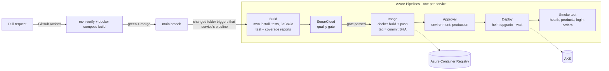

# CI/CD (Session 6)

Every merge to `main` builds, tests, analyses and deploys **only the services whose files changed**.
Pull requests are checked by GitHub Actions; deploys are done by Azure Pipelines.

## Flow

| Stage | What | Fails when |
|---|---|---|
| Build | `mvn -pl <service> -am install`: compile, unit + Testcontainers tests, JaCoCo coverage; test and coverage reports published to the run | a test fails |
| SonarCloud | `mvn sonar:sonar -Dsonar.qualitygate.wait=true` | the quality gate fails (new bugs, vulnerabilities, coverage on new code < 80%, duplication) |
| Image | `docker build --build-arg MODULE=<service>` + push to ACR, tagged with the full commit SHA | the image doesn't build |
| Deploy | waits for approval, then `helm upgrade --install <service> charts/service --wait`, then `scripts/smoke/smoke.sh` | pods don't become ready in 10 min, or the smoke test fails |

Which pipeline runs:

| Change in | Pipelines |
|---|---|
| `product-service/` | product-service |
| `common/` | user-service, product-service, order-service |
| `pom.xml`, `Dockerfile`, `charts/service/` | all six |
| `docs/`, `README.md` | none |
| `infra/terraform/` | infra-plan (shows the Terraform plan; apply is done by hand) |

## Infrastructure as code

| Piece | File |
|---|---|
| Azure resources (RG, ACR, AKS, PostgreSQL + 3 DBs, Storage + container, AcrPull role) | `infra/terraform/azure/*.tf` |
| Terraform state (kept outside, survives destroy) | storage account in `rg-ecommerce-tfstate`, see `backend.hcl` |
| One Helm release per service | `charts/service` + `deploy/values/<service>.yaml` |
| Shared settings, secrets, ingress | `charts/platform` (installed by `infra-up.ps1` from Terraform outputs) |

Secrets (DB password, JWT key, storage key, admin password) are generated by Terraform, kept in its
state, and copied into the Kubernetes Secret by `infra-up.ps1`. None are in Git or in the pipeline.

## One-time setup

**SonarCloud** (free for public repos)
1. sonarcloud.io, log in with GitHub, **+ > Create new organization > Import from GitHub**, pick your account.
   Note the organization key (e.g. `yangm123321`).
2. **My Account > Security**: generate a token.
3. `powershell -ExecutionPolicy Bypass -File scripts\sonar\create-projects.ps1 -Organization <key> -Token <token>`

**Azure DevOps**
1. dev.azure.com, sign in with the same Microsoft account as Azure, create an organization and a
   project `ecommerce-platform` (Private).
2. **Free hosted agents:** new organizations get no free pipeline minutes until Microsoft approves a
   request: https://aka.ms/azpipelines-parallelism-request (choose private projects; usually 1-3 business days).
3. **Project settings > Service connections > New > Azure Resource Manager > Workload identity
   federation (automatic)**, scope **Subscription**, no resource group, name **`azure-ecommerce`**,
   tick *Grant access permission to all pipelines*.
4. **Pipelines > Library > + Variable group** named **`ecommerce-azure`** with values from
   `terraform output` (run in `infra/terraform/azure`):

   | Variable | Value |
   |---|---|
   | ACR_NAME | `terraform output -raw acr_name` |
   | ACR_LOGIN_SERVER | `terraform output -raw acr_login_server` |
   | AKS_RESOURCE_GROUP | `rg-ecommerce` |
   | AKS_NAME | `aks-ecommerce` |
   | SONAR_ORGANIZATION | your SonarCloud organization key |
   | SONAR_TOKEN | the SonarCloud token, padlock clicked (secret) |

   These stay valid after destroy + apply because the names come from the fixed suffix in `terraform.tfvars`.
5. **Pipelines > Environments > New environment** `production` (None). Then **... > Approvals and
   checks > + > Approvals**, approver = you.
6. **Pipelines > New pipeline > GitHub > ecommerce-platform > Existing Azure Pipelines YAML file**,
   path `/.azure-pipelines/product-service.yml`, **Save** (not Run), then rename it `product-service`.
   Repeat for the other five services and `infra-plan.yml`.
7. The first run of each asks to **Permit** access to the variable group, service connection and
   environment. Click **View > Permit**.

## Day to day

- Work on a branch, open a PR, GitHub Actions checks it, merge.
- Azure Pipelines starts for each changed service. Approve the Deploy stage when it pauses.
- Watch it: Pipelines > Runs. Tests tab = test report, Code Coverage tab = JaCoCo, SonarCloud link in the log.
- Infrastructure must be up (`infra-up.ps1`) for Deploy to work. Build, SonarCloud and Image also
  need the registry, so start the infrastructure before merging.
